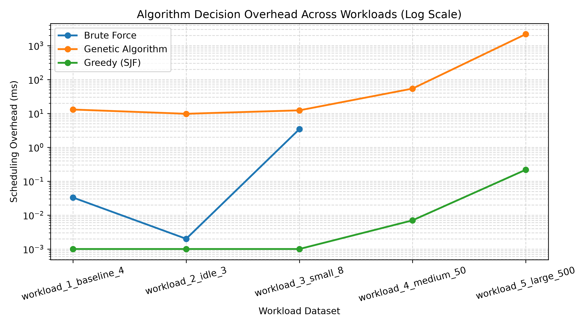
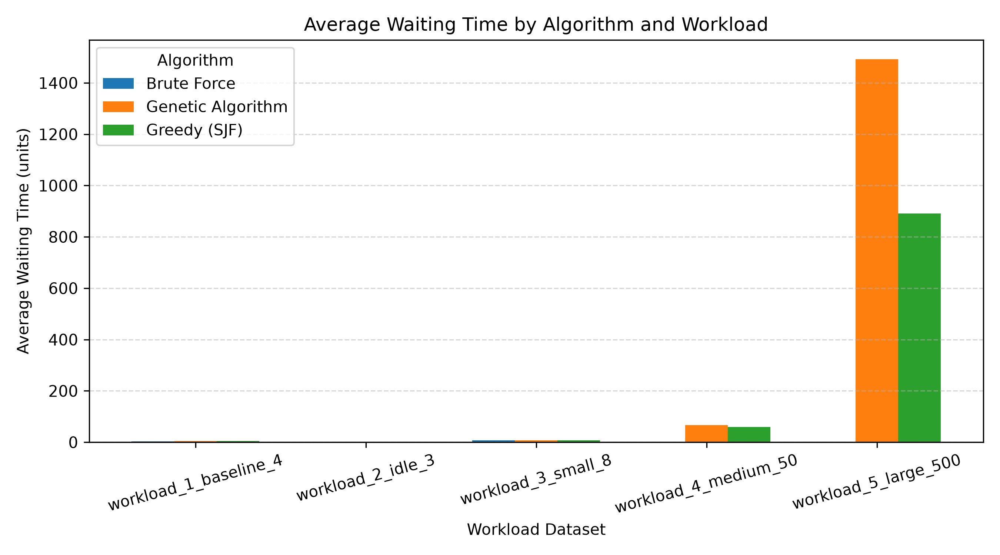
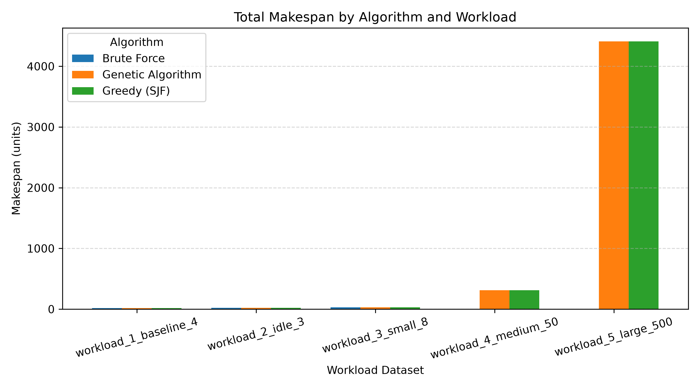

# Comparative CPU Task Scheduling Optimization

## Project Overview
This project evaluates algorithmic trade-offs across CPU task scheduling paradigms under diverse workload scenarios. The objective is to analyze how different scheduling strategies balance CPU scheduling overhead against execution efficiency, specifically minimizing average waiting time, average turnaround time, and total makespan.

For the full theoretical background and research plan, see the [Project Proposal](docs/proposal.pdf).

- **Inputs:** Task sets defined by Task ID, Arrival Time, Burst/Execution Time, and Priority.
- **Outputs:** An ordered task execution schedule with computed completion, turnaround, and waiting times.
- **Optimization Criteria:** Minimizing average waiting time, average turnaround time, and algorithm decision overhead.

---

## Team Members & Responsibilities
- **Gabriel Holman:** Brute-Force Algorithm implementation.
- **Hunter Clan:** Genetic Algorithm implementation.
- **Caleb Fletcher:** Greedy Algorithm implementation.

---

## Algorithms

### 1. Brute Force
- **Approach:** Evaluates all possible valid execution sequences across the task set to guarantee the absolute globally optimal schedule.
- **Complexity:** Combinatorial explosion, requiring capped problem sizes during benchmarking.

### 2. Genetic Algorithm
- **Approach:** Represents candidate task orders as chromosomes within an evolving population. Applies selection, crossover, and mutation heuristics across successive generations to converge on near-optimal schedules without exhaustive search.

### 3. Greedy Algorithm
- **Approach:** Employs Non-Preemptive Shortest Job First (SJF). At each scheduling boundary, the scheduler dispatches the available arrived task with the minimal burst time (breaking ties by earliest arrival).

---

## Building and Running

### Prerequisites
- C++17 compliant compiler (`g++` or `clang++`)
- GNU `make` (optional; supported on macOS, Linux, and Windows via `mingw32-make`)

### Option 1: Using Make (macOS / Linux / Windows)
- Compile all three executables into `bin/`:
```bash
make               # macOS / Linux
mingw32-make       # Windows (PowerShell / CMD)
```

- To remove compiled binaries:
```bash
make clean         # macOS / Linux
mingw32-make clean # Windows
```

### Option 2: Direct Compilation with `g++` (Any OS / No `make` Required)
- Create a `bin` directory and compile any algorithm directly:
```bash
mkdir bin
g++ -std=c++17 -Wall -Wextra -O2 -Isrc -o bin/brute_force src/brute_force/main.cpp
g++ -std=c++17 -Wall -Wextra -O2 -Isrc -o bin/genetic src/genetic/main.cpp
g++ -std=c++17 -Wall -Wextra -O2 -Isrc -o bin/greedy src/greedy/main.cpp
```

### Execution Commands
- **macOS / Linux:**
```bash
./bin/brute_force tests/test_inputs/workload_1_baseline_4.txt
./bin/genetic tests/test_inputs/workload_1_baseline_4.txt
./bin/greedy tests/test_inputs/workload_1_baseline_4.txt
```

- **Windows (PowerShell / CMD):**
```powershell
.\bin\brute_force.exe tests/test_inputs/workload_1_baseline_4.txt
.\bin\genetic.exe tests/test_inputs/workload_1_baseline_4.txt
.\bin\greedy.exe tests/test_inputs/workload_1_baseline_4.txt
```

---

## Example Input and Output

### Input (`tests/test_inputs/workload_1_baseline_4.txt`)
```text
# Workload 1: Baseline Workload
# Schema: ID ArrivalTime BurstTime Priority
T1 0 7 2
T2 2 4 1
T3 4 1 3
T4 5 4 2
```

### Brute Force Expected Output
```text
--- Brute Force Results ---
Input Workload:       tests/test_inputs/workload_1_baseline_4.txt
Tasks Scheduled:      4
Schedule Order:       T2 -> T3 -> T4 -> T1
Total Makespan:       18 units
Avg Waiting Time:     3.750 units
Avg Turnaround Time:  7.750 units
Scheduling Overhead:  0.000 ms
```

### Genetic Algorithm Expected Output
```text
--- Genetic Algorithm Results ---
Input Workload:       tests/test_inputs/workload_1_baseline_4.txt
Tasks Scheduled:      4
Schedule Order:       T1 -> T3 -> T2 -> T4
Total Makespan:       16 units
Avg Waiting Time:     4.000 units
Avg Turnaround Time:  8.000 units
Scheduling Overhead:  8.623 ms
```

### Greedy Algorithm Expected Output
```text
--- Greedy Algorithm (Shortest Job First) Results ---
Input Workload:       tests/test_inputs/workload_1_baseline_4.txt
Tasks Scheduled:      4
Schedule Order:       T1 -> T3 -> T2 -> T4
Total Makespan:       16 units
Avg Waiting Time:     4.000 units
Avg Turnaround Time:  8.000 units
Scheduling Overhead:  0.001 ms
```

> **Note on Large Workloads:** For workloads exceeding 15 tasks (such as `workload_5_large_500.txt`), the console output automatically shortens the schedule sequence to keep logs concise while reporting full summary metrics.

---

## Experimental Results

### Benchmark Methodology
- **Workload Provenance & Tiers:** All datasets in `tests/test_inputs/` are synthetic benchmarks constructed for this study. Small workloads (`workload_1_baseline_4`, `workload_2_idle_3`, and `workload_3_small_8`) were hand-crafted to test CPU idle-gap handling, tie-breaking, and exact optimality against Brute Force, while larger workloads (`workload_4_medium_50` and `workload_5_large_500`) were synthetically generated to evaluate asymptotic scaling.
- **Input-Size Cutoff:** Because Brute Force evaluates all $N!$ task permutations, execution is capped at $N \le 15$ (`workload_1` through `workload_3`) to prevent combinatorial explosion.
- **Genetic Algorithm Configuration & Reproducibility:** Evaluated with `POPULATION_SIZE = 100`, `GENERATIONS = 200`, `MUTATION_RATE = 0.05`, tournament selection with 5% elitism, and a fixed random seed (`RANDOM_SEED = 42`) for reproducible single-trial benchmark runs.
- **Measurement Environment:** All executables were compiled with `g++ -std=c++17 -O2` and timed internally via `std::chrono::high_resolution_clock` (decision overhead reported in milliseconds alongside schedule makespan, average waiting time, and average turnaround time).

Full benchmark metrics are stored in [`results/raw_data/benchmark_results.csv`](results/raw_data/benchmark_results.csv), with comparative charts in [`results/graphs/`](results/graphs/).

| Algorithm | Workload | Tasks ($N$) | Makespan | Avg Waiting Time | Avg Turnaround Time | Overhead (ms) |
| :--- | :--- | :---: | :---: | :---: | :---: | :---: |
| **Brute Force**       | `workload_1_baseline_4` | 4 | 18 | 3.750 | 7.750 | 0.008 |
| **Brute Force**       | `workload_2_idle_3`     | 3 | 22 | 0.000 | 3.667 | 0.002 |
| **Brute Force**       | `workload_3_small_8`    | 8 | 32 | 7.000 | 11.000 | 4.678 |
| **Genetic Algorithm** | `workload_1_baseline_4` | 4 | 16 | 4.000 | 8.000 | 10.135 |
| **Genetic Algorithm** | `workload_2_idle_3`     | 3 | 22 | 0.000 | 3.667 | 6.428 |
| **Genetic Algorithm** | `workload_3_small_8`    | 8 | 32 | 7.000 | 11.000 | 36.892 |
| **Genetic Algorithm** | `workload_4_medium_50`  | 50 | 311 | 66.540 | 72.760 | 60.026 |
| **Genetic Algorithm** | `workload_5_large_500`  | 500 | 4411 | 1492.550 | 1501.372 | 2324.285 |
| **Greedy (SJF)**      | `workload_1_baseline_4` | 4 | 16 | 4.000 | 8.000 | 0.000 |
| **Greedy (SJF)**      | `workload_2_idle_3`     | 3 | 22 | 0.000 | 3.667 | 0.000 |
| **Greedy (SJF)**      | `workload_3_small_8`    | 8 | 32 | 7.000 | 11.000 | 0.001 |
| **Greedy (SJF)**      | `workload_4_medium_50`  | 50 | 311 | 59.140 | 65.360 | 0.007 |
| **Greedy (SJF)**      | `workload_5_large_500`  | 500 | 4411 | 891.780 | 900.602 | 0.160 |

### Key Findings
- **Combinatorial Explosion (Brute Force):** Exhaustive search guarantees global optimality on small task sets (`3.750` units average waiting time on `workload_1_baseline_4`), but decision overhead grows by more than two orders of magnitude between $N=4$ and $N=8$, making $N > 15$ computationally unfeasible.
- **Metaheuristic Search Budget Trade-off (Genetic Algorithm):** With a fixed evolutionary budget, the Genetic Algorithm converges on optimal work-conserving schedules for $N \le 8$, but its fixed evaluation budget limits convergence across the $500!$ search space while incurring `2324.285 ms` of scheduling overhead.
- **Scalability & Efficiency (Greedy SJF):** Non-preemptive SJF matches optimal work-conserving performance on small workloads while scaling to $N=500$ in `0.160 ms`—achieving **40.3% lower average waiting time** and **~14,500× lower scheduling overhead** than the Genetic Algorithm at scale.

### Comparative Visualizations




---

## Generative AI Statement
The authors acknowledge the utilization of Gemini, a language model developed by
Google, in the preparation of this assignment. The Gemini model was employed in the
following manner within this assignment: code assistance/review, repository setup assistance, research, brainstorming.